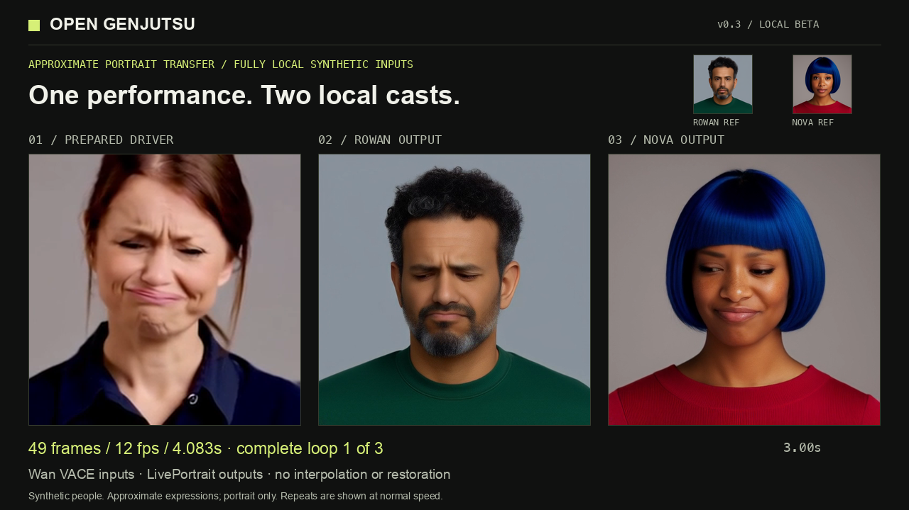

# Open Genjutsu

A local-first studio for reference-conditioned video workflows in ComfyUI. Bring a driving clip and a character image, make short previews, compare the result, and keep the graph and inputs with every take.

**v0.3 portrait beta · updated 23 October 2026.** Optional Comfy Router BYOK is now implemented. Local rendering stays keyless and is selected by default. The public fictional-character demo uses independently generated local inputs and local LivePortrait output: **49 frames at 12 fps, or 4.08 seconds**, from one performance applied to two references. Expressions and gaze are approximate; this is portrait animation, without a full-body, scene-replacement or Higgsfield quality-parity claim. The separate hosted route is implemented and protocol-tested, but no real paid provider generation or hosted output-quality test has been run.



[Watch the 58.25-second demo](https://stoicenso.github.io/open-genjutsu/2026-10-23-demo-Codex/) · [Download film](docs/assets/2026-10-23-submission-demo-Codex.mp4) · [Local casting comparison](docs/assets/2026-10-23-local-casting-comparison-Codex.mp4) · [Portrait reaction clip](docs/assets/2026-10-23-influencer-reaction-Codex.mp4) · [Verification](docs/2026-10-23-router-and-influencer-verification-Codex.md)

[Earlier real-human tests and limits](docs/2026-10-23-human-footage-verification-Codex.md) · [Earlier illustrated VACE baseline](docs/2026-10-21-verification-Codex.md). Synthetic footage is not a real-human benchmark.

## What it does

- Frontal portrait performance transfer with explicit face crops and a visible motion amount.
- Experimental character stylization and prompt-directed scene resynthesis using VACE.
- Batch casting: queue the same driving motion against up to five separate references.
- Source/result playback with synchronized side-by-side and wipe comparison.
- Saved jobs, input hashes, exact SDK execution graphs, and portable project export.
- Immutable saved recipes: reopening a take retains its workflow revision and original local engine.
- Browser interface on localhost and a Mac application sharing the same frontend and backend.
- Keyless local execution by default, with no automatic cloud fallback.
- A separate optional paid Comfy Router mode: whole-file upload consent, a returned estimate, then approval of one hosted request. No provider key is needed for Local mode.

Choose the performance window and source/reference crops before rendering. Originals remain intact; receipts and project ZIPs retain the exact prepared inputs, crop regions, FPS, start time and hashes. Rotated phone footage is normalized before cropping. The comparison shows the prepared performance window alongside the actual output.

Inspect the recorded [Nova project](docs/examples/2026-10-23-local-cast-projects-Codex/2026-10-23-nova-project-Codex.zip) and [Rowan project](docs/examples/2026-10-23-local-cast-projects-Codex/2026-10-23-rowan-project-Codex.zip). Each contains original/prepared inputs, actual output, hashes, receipt and `portable-workflow-api.json`. Follow the included bundle instructions: the manifest’s authored `workflow.graph` retains preset defaults, while the receipt, recorded parameters and portable graph describe the executed 49-frame, motion-1.0 take. Their contents were verified; these two current exports have not been rerendered as a new runtime-replay test.

Previews accept **up to 49 frames** at the workflow’s actual FPS. At 16 fps, 33 frames span 2.06 seconds. VACE canvases have a maximum 480px edge; the portrait lane takes square 256px inputs and decodes a 512px portrait. This output resolution is not a promise of recovered source detail. The app fits selected regions with padding, without stretching or enlarging source pixels. Incomplete windows are rejected before model submission.

## Run locally

Common prerequisites:

- Node.js 22 or newer.
- `ffmpeg` and `ffprobe` installed locally. On macOS, the app also discovers standard Homebrew paths. No FFmpeg binary is redistributed in this repository or Mac package.

The current work is on the [human-footage-quality branch](https://github.com/StoicEnso/open-genjutsu/tree/codex/human-footage-quality) while its pull request is pending:

```bash
git clone --branch codex/human-footage-quality https://github.com/StoicEnso/open-genjutsu.git
cd open-genjutsu
npm ci
npm run dev
```

Open **http://127.0.0.1:5173**. The app API listens on loopback port 4317. For **Local** mode, also install a recent [ComfyUI](https://github.com/Comfy-Org/ComfyUI), the selected workflow’s models/nodes, and the official [comfy-api-proxy](https://github.com/Comfy-Org/comfy-api-proxy). Run ComfyUI and its proxy in separate terminals:

```bash
# Terminal 1, from your ComfyUI environment and directory:
python main.py --listen 127.0.0.1 --port 8188

# Terminal 2, in the Python environment you will use for the proxy:
python -m pip install comfy-api-proxy==0.1.6
comfy-api-proxy run --host 127.0.0.1 --port 8189 --comfyui http://127.0.0.1:8188
```

Use **Engine** in the app to check connections and missing requirements. Model downloads are not automatic. A tiny GPU operation or a successful file-copy workflow is not proof that a video model fits your hardware.

### Smallest working portrait setup

Use Python 3.11+ in your **existing ComfyUI environment**, then run from this repository:

```bash
python -m pip install -r scripts/portrait/requirements.txt
python scripts/portrait/install.py --comfy-dir /path/to/ComfyUI
```

The explicit installer fetches the pinned MIT LivePortrait core and **522MB** of core weights, checks their sizes and SHA-256 hashes, and installs the node atomically. It does not start inference or change provider accounts. Restart ComfyUI afterward. Torch, NumPy, SciPy, PyYAML and rich come from the existing Comfy environment. The adapter honors its CPU/MPS/CUDA device selection; CPU/CUDA performance has not been benchmarked here.

No InsightFace, automatic face detector, external landmark weights or animal models are installed or imported. Crops are manual. Choose **Portrait Performance — Local**, upload a clear frontal reference and a short near-frontal human clip, set square crops including forehead and chin, then render. Start with motion amount **0.35**. Full relative motion **1.0** worked on the tested modern frontal blink; larger turns and painted three-quarter faces can ghost. Scene reshoot is disabled for this portrait-only workflow.

For offline setup, the installer accepts `--source-dir` for a Git checkout containing the pinned upstream commit and `--weights-dir` for the five files under `liveportrait/`. It reads committed source blobs, not modified working files, and fails rather than fetching missing blobs in offline mode. Exact pins: [models.json](scripts/portrait/models.json). Code/weight checks run before the node is available; nothing downloads during a render.

For the larger VACE workflow, the [pinned Apple Silicon runtime recipe](runtime/README.md) records the exact source revisions and SHA-256-checked model files used in the earlier preview. That optional route downloads about 8.22GB of weights into a new folder. No paid account is needed. The combined bootstrap script has not been rerun in a second clean environment.

```bash
npm test             # SDK protocol, recovery, export and security tests
python3 -m unittest discover -s tests -p python_adapter_test.py -v  # Offline adapter/installer protocol
npm run build        # TypeScript + frontend + local server
npm start            # Production web app at http://127.0.0.1:4317
npm run desktop      # Build and launch the desktop app
npm run package:mac  # Development .app under release/mac-arm64/
```

The Mac build is a development package, without Apple notarization. It does not include model weights, ComfyUI, Python or FFmpeg. Local mode needs those external inference components; Router mode needs local FFmpeg/FFprobe for media validation but does not need a local inference server or GPU. The v0.3 ARM64 package built and launched successfully, rendered the final neutral-Rowan take in **50.117 seconds**, and reopened its saved take. This uses the existing configured runtime; a fresh-machine installation has not been verified.

## Optional Comfy Router mode

Choose **Comfy Router** in the studio and add a real Comfy workspace API key. Browser/server mode keeps it in the server session by default. On the Mac app, **Remember securely on this Mac** optionally writes a `0600` ciphertext file under Electron’s `userData/credentials/comfy-router.encrypted`, encrypted with Electron `safeStorage` using the OS-backed key. There is no plaintext fallback. The key is not placed in browser storage, signed media URLs, public receipts or project exports. Forgetting it removes the session key and attempts to remove the saved ciphertext.

This typed adapter targets only **Seedance 2.0 reference video**, `byteplus/dreamina-seedance-2-0-260128`, through [Comfy Router](https://docs.comfy.org/development/comfy-router/quickstart). It does not enable paid nodes in imported workflow graphs or arbitrary remote Comfy endpoints.

1. Choose a whole MP4/MOV clip up to 15 seconds and 20 MB, plus a PNG/JPEG reference up to 10 MB. Local crop/start selections do not apply.
2. Explicitly approve sending both original files to Comfy storage, then select **Upload & get price**. Uploads may be retained by Comfy. This does not start a render.
3. Review the exact files, model, settings and USD estimate. A separate confirmation approves one paid generation using your **Comfy workspace credits**, not Higgsfield website credits.

The workspace needs Asset API, estimate and model-queue access plus sufficient funds. A `403` or unusable estimate blocks generation. No key, account upgrade or top-up is supplied by this app. Estimates are not price locks or billing caps; failed or cancelled requests may still be billed. An ambiguous submission is never automatically resubmitted, and recovery follows a saved provider receipt. Local mode remains available without this account. **BYOK does not mean free inference.** See [verification and remaining limits](docs/2026-10-23-router-and-influencer-verification-Codex.md).

## Included workflow packs

| Pack | Purpose | Important limits |
| --- | --- | --- |
| `workflows/liveportrait-portrait.json` | Lightweight photographic portrait performance transfer | Tested with real human motion. Explicit square face crops; 512px portrait output. Approximate expressions, best with small frontal motion. |
| `workflows/wan-vace-human-quality.json` | Muted Van Gogh painting study, 28-step VACE at 16 fps | Actual human turn tested. Prompt changes reduced saturation; reference likeness and facial anatomy still drift. |
| `workflows/wan-vace-1.3b.json` | Smaller reference + Canny-conditioned local feasibility preview | Four-step execution baseline. Identity quality is unproven; not a production-quality preset. Requires ComfyUI-GGUF for its quantized text encoder. |
| `workflows/wan-vace-1.3b-detail.json` | Twenty-step version of the smaller VACE workflow | A separate sampling-quality evaluation. More steps do not guarantee correct hands or identity. |
| `workflows/wan-animate-2.json` | Native Wan Animate 2 driving-video motion transfer | 14B backend; substantial memory requirements. Not benchmarked on a 24GB Mac. It may generate a new background. |

The app checks node presence, selected filenames, audited local node classes, and SDK-proxy availability before submitting. For VACE, file presence is metadata rather than a checksum audit. The portrait node additionally verifies its pinned installation files; neither readiness check certifies output quality. Download models from the sources recorded in each pack and verify them before use. Quantization does not change the original model license.

On the tested M4 Pro with 24GB unified memory, the four-step 256×256/17-frame run took about 97 seconds end to end; denoising itself took about nine seconds. System swap grew substantially. Process RSS omits GPU allocations. Freeing the task-owned Comfy caches afterward recovered available RAM. This is an observed small-preview result, not a claim that larger video models or long clips fit comfortably on this machine.

The complete app also executed the twenty-step pack, retained its remote job ID, recovered its output without another render, and exported a project whose input/output hashes were verified. Comfy reported about 94 seconds of execution. The longer app wall time included recovery from a now-fixed output-metadata mismatch, so it is not a clean speed benchmark.

## Workflow packs

Import a JSON **pack**, rather than a UI canvas export. It contains an API-format Comfy graph and explicit scalar input bindings:

```json
{
  "id": "my-local-workflow",
  "name": "My local workflow",
  "description": "Describe its actual behavior and limitations.",
  "graph": {
    "1": { "class_type": "LoadVideo", "inputs": { "file": "source.mp4" } },
    "2": { "class_type": "LoadImage", "inputs": { "image": "reference.png" } }
  },
  "bindings": {
    "sourceVideo": { "nodeId": "1", "input": "file" },
    "referenceImage": { "nodeId": "2", "input": "image" }
  },
  "outputNodeIds": ["YOUR_SAVE_VIDEO_NODE"],
  "license": "Specify code and model licenses separately",
  "provenance": { "source": "https://example.com/original-workflow" }
}
```

This abbreviated example is a format illustration, not an executable generation graph. Add the actual conditioning, model, sampler, decode and output nodes. Optional graph controls are `prompt`, `seed`, `width`, `height`, `frames`, `fps` and `motionStrength`, each bound to an existing scalar input. `startSeconds`, `sourceCrop` and `referenceCrop` select the source window and normalized crop regions during preparation, rather than graph bindings. Crop coordinates refer to the original displayed/autorotated frame before padding. `motionStrength` is a bounded 0–1 scalar bound to the portrait node. If FPS is fixed in `CreateVideo`, preparation uses that same value. A pack can record `metadata.video.fps` for validation; it must agree with the graph. Unexposed controls are not submitted. Imported graphs do not gain permission to run unaudited custom or provider nodes.

## Files and privacy

Application state and media live outside the repository, under the platform application-data directory. The Mac app uses a `desktop-workspace` subfolder in its Electron `userData` directory. Set `OPEN_GENJUTSU_DATA_DIR` to choose a workspace. A workspace lock prevents two server processes from overwriting the same state. A browser can use the desktop server's local URL to share that running workspace.

In Local mode, the source and reference go only to the configured loopback Comfy proxy, with inherited cloud credentials excluded. In Cloud mode, the separately approved quote operation uploads the whole originals outside the device; the paid model request needs its own confirmation. Private cloud-tracking state retains signed input links, but public receipts omit them. OS-level local users and processes can access a local service; this is not a multi-user hosted backend. Host, origin, redirects and backend links are checked. No analytics are added by the app.

Useful environment variables:

| Variable | Purpose |
| --- | --- |
| `OPEN_GENJUTSU_PORT` | Local API port; default 4317 |
| `OPEN_GENJUTSU_DATA_DIR` | State and media directory |
| `OPEN_GENJUTSU_FFMPEG` | Explicit path to a local FFmpeg executable |
| `OPEN_GENJUTSU_FFPROBE` | Explicit path to a local FFprobe executable |

Remote self-hosted servers and arbitrary provider endpoints remain unsupported. Cloud access is confined to the separate audited Comfy Router adapter.

## Provenance and competition

Built for the [Open Source Higgsfield competition](https://comfy.org/open-source-higgsfield/) using [`@comfyorg/sdk`](https://github.com/Comfy-Org/comfy-typescript-sdk) against a self-hosted Comfy proxy, plus the optional typed Router adapter. The rules checked on 23 October permit entirely local ComfyUI and allow one submission per person. The deadline is **30 October 2026, 09:00 PDT / 16:00 UTC**. Best Overall consideration is automatic. No Open Weights Only claim is made for the app with its optional closed-model cloud route; no prize or existing viral traction is claimed.

The product contract was studied from the public Genjutsu interface and shipped browser scripts, including actual REA 6.7 static analysis with retained evidence and coverage limitations. No proprietary bundles, branding, demo media, account data, or server implementation are copied into this repository. Public client code cannot establish Higgsfield's private model, quality, timing, or rendering algorithm.

Motion transfer and agent-assisted video are established areas. Related open projects include [LivePortrait](https://github.com/KwaiVGI/LivePortrait), [Mix Studio](https://github.com/BlackMixture/Mix-Studio), [Castcut](https://github.com/doodersrage/castcut), [VACE](https://github.com/ali-vilab/VACE), and Comfy's own examples. The contribution here is the local product workflow, explicit readiness, durable recipes, and inspectable execution—not a new foundation model.

The primary demo uses independently generated **local synthetic** inputs. Modern stock and Higgsfield-generated development inputs and their derivative outputs are excluded from that demo and remain private. Higgsfield’s output-ownership terms do not settle its separate restriction on using the service or outputs to develop competing products; no breach or blanket permission is certified. Earlier historical-source tests retain their credits and limitations in the human-footage report. The final app film is **58.25 seconds**, and the public media, input-generation graphs and provenance are included. Personal application answers, a transmitted social post and the final application submission remain pending; this repository does not certify an organizer ruling.

## License

Application code and original workflow-pack glue: [MIT](LICENSE). ComfyUI, ComfyUI-GGUF, model weights, Electron and local FFmpeg have separate licenses; see pack provenance and [THIRD_PARTY_NOTICES.md](THIRD_PARTY_NOTICES.md).
