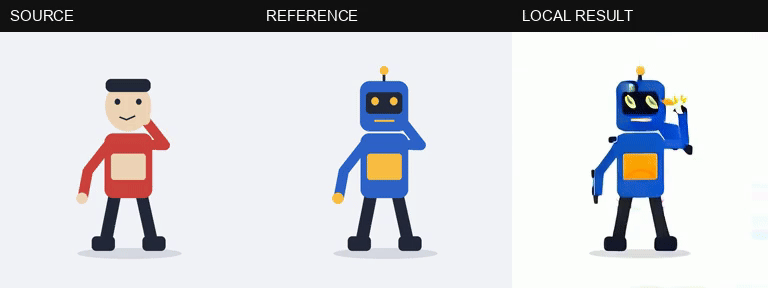

# Open Genjutsu

A local-first studio for reference-conditioned video workflows in ComfyUI. Bring a driving clip and a character image, make short previews, compare the result, and keep the graph and inputs with every take.

**Early development build.** The interface, persistent job runner, official Comfy SDK integration, workflow inspection, and Mac packaging are implemented. A real local VACE run produced a coherent illustrated robot animation at 256×256 and 17 frames, with visible hand distortion. Human recasting and longer-clip quality remain unverified. This is an independent reconstruction of useful product interactions, not a claim of Higgsfield model or output parity.



Actual 20-step result, 17 frames / 0.71 seconds, repeating at approximately its original speed. Both inputs are original procedural artwork. No external clips or proprietary demo assets are used. [MP4 comparison](docs/assets/2026-10-21-local-recast-Codex.mp4) · [Verification and limits](docs/2026-10-21-verification-Codex.md).

## What it does

- Character recasting and prompt-directed scene experiments using inspectable workflows.
- Batch casting: queue the same driving motion against up to five separate references.
- Source/result playback with synchronized side-by-side and wipe comparison.
- Saved jobs, input hashes, exact SDK execution graphs, and portable project export.
- Immutable saved recipes: reopening a take retains its workflow revision and original local engine.
- Browser interface on localhost and a Mac application sharing the same frontend and backend.
- Keyless local execution only. No analytics, subscriptions, provider keys, cloud fallback, or paid API nodes.

Current previews use the beginning of the source, up to **49 frames at 24fps**, with conditioning reduced to a maximum **480px edge**. Original uploads remain intact. This is about two seconds at the maximum setting, not a 30-second character-replacement promise. Generated backgrounds, camera behavior, identity, and motion fidelity depend on the selected model.

## Run locally

Prerequisites:

- Node.js 22 or newer.
- `ffmpeg` and `ffprobe` installed locally. On macOS, the app also discovers standard Homebrew paths. No FFmpeg binary is redistributed in this repository or Mac package.
- A recent [ComfyUI](https://github.com/Comfy-Org/ComfyUI) installation and the models/nodes required by the selected workflow.
- The official [comfy-api-proxy](https://github.com/Comfy-Org/comfy-api-proxy), a free adapter for the official SDK. Comfy Cloud is not required.

```bash
git clone https://github.com/StoicEnso/open-genjutsu.git
cd open-genjutsu
npm ci
npm run dev
```

Open **http://127.0.0.1:5173**. The app API listens on loopback port 4317. In another terminal, run your configured ComfyUI and its local proxy:

```bash
# From your ComfyUI environment:
python main.py --listen 127.0.0.1 --port 8188

# From an environment where comfy-api-proxy is installed:
comfy-api-proxy run --host 127.0.0.1 --port 8189 --comfyui http://127.0.0.1:8188
```

Use **Engine** in the app to check connections and missing requirements. Model downloads are not automatic. A tiny GPU operation or a successful file-copy workflow is not proof that a video model fits your hardware.

For Apple Silicon, the [pinned local runtime recipe](runtime/README.md) records the exact source revisions, Python packages and SHA-256-checked model files used for the working preview. It downloads about 8.22 GB of weights into a **new** folder; no paid account is needed. Review the recipe before running it. The individual runtime and model pins were exercised successfully; the combined bootstrap script has been syntax checked, not rerun in a second clean environment.

```bash
npm test             # SDK protocol, recovery, export and security tests
npm run build        # TypeScript + frontend + local server
npm start            # Production web app at http://127.0.0.1:4317
npm run desktop      # Build and launch the desktop app
npm run package:mac  # Development .app under release/mac-arm64/
```

The Mac build is a development package, without Apple notarization. It does not include model weights, ComfyUI, or the Python runtime. Local FFmpeg is required for media validation and bounded preview preparation.

## Included workflow packs

| Pack | Purpose | Important limits |
| --- | --- | --- |
| `workflows/wan-vace-1.3b.json` | Smaller reference + Canny-conditioned local feasibility preview | Four-step execution baseline. Identity quality is unproven; not a production-quality preset. Requires ComfyUI-GGUF for its quantized text encoder. |
| `workflows/wan-vace-1.3b-detail.json` | Twenty-step version of the smaller VACE workflow | A separate sampling-quality evaluation. More steps do not guarantee correct hands or identity. |
| `workflows/wan-animate-2.json` | Native Wan Animate 2 driving-video motion transfer | 14B backend; substantial memory requirements. Not benchmarked on a 24GB Mac. It may generate a new background. |

The app checks node presence, selected filenames, audited local node classes, and SDK-proxy availability before submitting. File presence is metadata, not a checksum or model-license audit. Download models from the sources recorded in each pack and verify them before use. Quantization does not change the original model license.

On the tested M4 Pro with 24GB unified memory, the four-step 256×256/17-frame run took about 97 seconds end to end; denoising itself took about nine seconds. System swap grew substantially. Process RSS omits GPU allocations. Freeing the task-owned Comfy caches afterward recovered available RAM. This is an observed small-preview result, not a claim that larger video models or long clips fit comfortably on this machine.

The complete app also executed the twenty-step pack, retained its remote job ID, recovered its output without another render, and exported a project whose input/output hashes were verified. Comfy reported about 94 seconds of execution. The longer app wall time included recovery from a now-fixed output-metadata mismatch, so it is not a clean speed benchmark.

## Workflow packs

Import a JSON **pack**, rather than a UI canvas export. It contains an API-format Comfy graph and explicit scalar input bindings:

```json
{
  "id": "my-local-workflow",
  "name": "My local workflow",
  "description": "Describe its actual behavior and limitations.",
  "graph": {
    "1": { "class_type": "LoadVideo", "inputs": { "file": "source.mp4" } },
    "2": { "class_type": "LoadImage", "inputs": { "image": "reference.png" } }
  },
  "bindings": {
    "sourceVideo": { "nodeId": "1", "input": "file" },
    "referenceImage": { "nodeId": "2", "input": "image" }
  },
  "outputNodeIds": ["YOUR_SAVE_VIDEO_NODE"],
  "license": "Specify code and model licenses separately",
  "provenance": { "source": "https://example.com/original-workflow" }
}
```

This abbreviated example is a format illustration, not an executable generation graph. Add the actual conditioning, model, sampler, decode and output nodes. Optional controls are `prompt`, `seed`, `width`, `height` and `frames`, each bound to an existing scalar input. Unexposed controls are not submitted. Imported graphs do not gain permission to run unaudited custom or provider nodes.

## Files and privacy

Application state and media live outside the repository, under the platform application-data directory. The Mac app uses a `desktop-workspace` subfolder in its Electron `userData` directory. Set `OPEN_GENJUTSU_DATA_DIR` to choose a workspace. A workspace lock prevents two server processes from overwriting the same state. A browser can use the desktop server's local URL to share that running workspace.

The source video and reference are uploaded only to the configured local Comfy proxy. This initial release accepts loopback addresses only. OS-level local users and processes can access a local service; this is not a multi-user hosted backend. Host, origin, redirects and backend links are checked, and inherited Comfy cloud credentials are excluded.

Useful environment variables:

| Variable | Purpose |
| --- | --- |
| `OPEN_GENJUTSU_PORT` | Local API port; default 4317 |
| `OPEN_GENJUTSU_DATA_DIR` | State and media directory |
| `OPEN_GENJUTSU_FFMPEG` | Explicit path to a local FFmpeg executable |
| `OPEN_GENJUTSU_FFPROBE` | Explicit path to a local FFprobe executable |

Provider BYOK and remote self-hosted servers are future work. A provider key would enable billable usage; BYOK does not mean free inference.

## Provenance and competition

Built for the [Open Source Higgsfield competition](https://comfy.org/open-source-higgsfield/) using [`@comfyorg/sdk`](https://github.com/Comfy-Org/comfy-typescript-sdk) against a self-hosted Comfy proxy. Current rules allow one submission per person, so multiple workflows belong to this one app.

The product contract was studied from the public Genjutsu interface and shipped browser scripts, including actual REA 6.7 static analysis with retained evidence and coverage limitations. No proprietary bundles, branding, demo media, account data, or server implementation are copied into this repository. Public client code cannot establish Higgsfield's private model, quality, timing, or rendering algorithm.

Motion transfer and agent-assisted video are established areas. Related open projects include [Mix Studio](https://github.com/BlackMixture/Mix-Studio), [Castcut](https://github.com/doodersrage/castcut), [VACE](https://github.com/ali-vilab/VACE), and Comfy's own examples. The contribution here is the local product workflow, explicit readiness, durable recipes, and inspectable execution—not a new foundation model.

## License

Application code and original workflow-pack glue: [MIT](LICENSE). ComfyUI, ComfyUI-GGUF, model weights, Electron and local FFmpeg have separate licenses; see pack provenance and [THIRD_PARTY_NOTICES.md](THIRD_PARTY_NOTICES.md).
