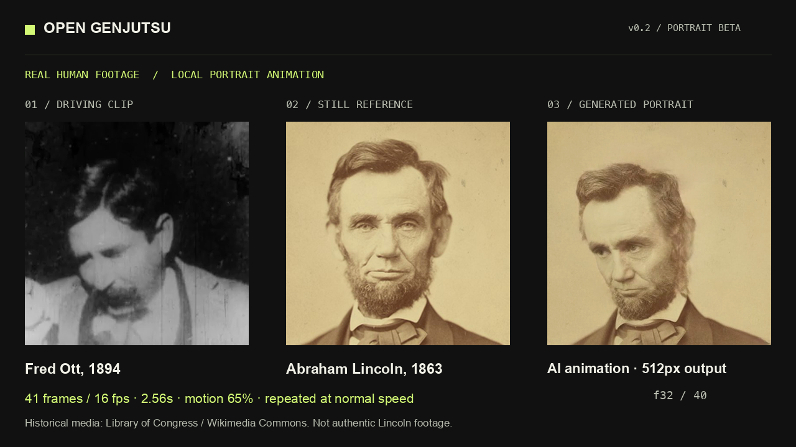

# Open Genjutsu

A local-first studio for reference-conditioned video workflows in ComfyUI. Bring a driving clip and a character image, make short previews, compare the result, and keep the graph and inputs with every take.

**v0.2 local portrait beta.** Real human footage now drives a photographic portrait through an offline, core-only LivePortrait workflow. A 33-frame human blink test completed through the app in **36.9 seconds** on an M4 Pro / 24GB Mac, preserving the reference’s appearance with approximate eyelid motion. A separate historical-human example completed in **26.1 seconds**; its exported project replayed with all 25 decoded frames matching on the same runtime. Large head turns, angled paintings and full-body recasting still have visible quality limits. This is an independent open-source product, without a Higgsfield model or quality-parity claim.



[34-second showcase](docs/assets/2026-10-23-open-genjutsu-showcase-Codex.mp4) · [Normal-speed human portrait comparison](docs/assets/2026-10-23-human-portrait-comparison-Codex.mp4) · [Working Mac app](docs/assets/2026-10-23-working-mac-app-Codex.png)

[Human-footage verification and limits](docs/2026-10-23-human-footage-verification-Codex.md) · [Earlier illustrated VACE baseline](docs/2026-10-21-verification-Codex.md)

## What it does

- Frontal portrait performance transfer with explicit face crops and a visible motion amount.
- Experimental character stylization and prompt-directed scene resynthesis using VACE.
- Batch casting: queue the same driving motion against up to five separate references.
- Source/result playback with synchronized side-by-side and wipe comparison.
- Saved jobs, input hashes, exact SDK execution graphs, and portable project export.
- Immutable saved recipes: reopening a take retains its workflow revision and original local engine.
- Browser interface on localhost and a Mac application sharing the same frontend and backend.
- Keyless local execution only. No analytics, subscriptions, provider keys, cloud fallback, or paid API nodes.

Choose the performance window and source/reference crops before rendering. Originals remain intact; receipts and project ZIPs retain the exact prepared inputs, crop regions, FPS, start time and hashes. Rotated phone footage is normalized before cropping. The comparison shows the prepared performance window alongside the actual output.

Previews accept **up to 49 frames** at the workflow’s actual FPS. At 16 fps, 33 frames span 2.06 seconds. VACE canvases have a maximum 480px edge; the portrait lane takes square 256px inputs and decodes a 512px portrait. This output resolution is not a promise of recovered source detail. The app fits selected regions with padding, without stretching or enlarging source pixels. Incomplete windows are rejected before model submission.

## Run locally

Prerequisites:

- Node.js 22 or newer.
- `ffmpeg` and `ffprobe` installed locally. On macOS, the app also discovers standard Homebrew paths. No FFmpeg binary is redistributed in this repository or Mac package.
- A recent [ComfyUI](https://github.com/Comfy-Org/ComfyUI) installation and the models/nodes required by the selected workflow.
- The official [comfy-api-proxy](https://github.com/Comfy-Org/comfy-api-proxy), a free adapter for the official SDK. Comfy Cloud is not required.

```bash
git clone https://github.com/StoicEnso/open-genjutsu.git
cd open-genjutsu
npm ci
npm run dev
```

Open **http://127.0.0.1:5173**. The app API listens on loopback port 4317. In another terminal, run your configured ComfyUI and its local proxy:

```bash
# From your ComfyUI environment:
python main.py --listen 127.0.0.1 --port 8188

# Install the tested proxy in the Python environment you will use for it:
python -m pip install comfy-api-proxy==0.1.6
comfy-api-proxy run --host 127.0.0.1 --port 8189 --comfyui http://127.0.0.1:8188
```

Use **Engine** in the app to check connections and missing requirements. Model downloads are not automatic. A tiny GPU operation or a successful file-copy workflow is not proof that a video model fits your hardware.

### Smallest working portrait setup

Use Python 3.11+ in your **existing ComfyUI environment**, then run from this repository:

```bash
python -m pip install -r scripts/portrait/requirements.txt
python scripts/portrait/install.py --comfy-dir /path/to/ComfyUI
```

The explicit installer fetches the pinned MIT LivePortrait core and **522MB** of core weights, checks their sizes and SHA-256 hashes, and installs the node atomically. It does not start inference or change provider accounts. Restart ComfyUI afterward. Torch, NumPy, SciPy, PyYAML and rich come from the existing Comfy environment. The adapter honors its CPU/MPS/CUDA device selection; CPU/CUDA performance has not been benchmarked here.

No InsightFace, automatic face detector, external landmark weights or animal models are installed or imported. Crops are manual. Choose **Portrait Performance — Local**, upload a clear frontal reference and a short near-frontal human clip, set square crops including forehead and chin, then render. Start with motion amount **0.35**. Full relative motion **1.0** worked on the tested modern frontal blink; larger turns and painted three-quarter faces can ghost. Scene reshoot is disabled for this portrait-only workflow.

For offline setup, the installer accepts `--source-dir` for a Git checkout containing the pinned upstream commit and `--weights-dir` for the five files under `liveportrait/`. It reads committed source blobs, not modified working files, and fails rather than fetching missing blobs in offline mode. Exact pins: [models.json](scripts/portrait/models.json). Code/weight checks run before the node is available; nothing downloads during a render.

For the larger VACE workflow, the [pinned Apple Silicon runtime recipe](runtime/README.md) records the exact source revisions and SHA-256-checked model files used in the earlier preview. That optional route downloads about 8.22GB of weights into a new folder. No paid account is needed. The combined bootstrap script has not been rerun in a second clean environment.

```bash
npm test             # SDK protocol, recovery, export and security tests
python3 -m unittest discover -s tests -p python_adapter_test.py -v  # Offline adapter/installer protocol
npm run build        # TypeScript + frontend + local server
npm start            # Production web app at http://127.0.0.1:4317
npm run desktop      # Build and launch the desktop app
npm run package:mac  # Development .app under release/mac-arm64/
```

The Mac build is a development package, without Apple notarization. It does not include model weights, ComfyUI, or the Python runtime. Local FFmpeg is required for media validation and bounded preview preparation.

## Included workflow packs

| Pack | Purpose | Important limits |
| --- | --- | --- |
| `workflows/liveportrait-portrait.json` | Lightweight photographic portrait performance transfer | Tested with real human motion. Explicit square face crops; 512px portrait output. Approximate expressions, best with small frontal motion. |
| `workflows/wan-vace-human-quality.json` | Muted Van Gogh painting study, 28-step VACE at 16 fps | Actual human turn tested. Prompt changes reduced saturation; reference likeness and facial anatomy still drift. |
| `workflows/wan-vace-1.3b.json` | Smaller reference + Canny-conditioned local feasibility preview | Four-step execution baseline. Identity quality is unproven; not a production-quality preset. Requires ComfyUI-GGUF for its quantized text encoder. |
| `workflows/wan-vace-1.3b-detail.json` | Twenty-step version of the smaller VACE workflow | A separate sampling-quality evaluation. More steps do not guarantee correct hands or identity. |
| `workflows/wan-animate-2.json` | Native Wan Animate 2 driving-video motion transfer | 14B backend; substantial memory requirements. Not benchmarked on a 24GB Mac. It may generate a new background. |

The app checks node presence, selected filenames, audited local node classes, and SDK-proxy availability before submitting. For VACE, file presence is metadata rather than a checksum audit. The portrait node additionally verifies its pinned installation files; neither readiness check certifies output quality. Download models from the sources recorded in each pack and verify them before use. Quantization does not change the original model license.

On the tested M4 Pro with 24GB unified memory, the four-step 256×256/17-frame run took about 97 seconds end to end; denoising itself took about nine seconds. System swap grew substantially. Process RSS omits GPU allocations. Freeing the task-owned Comfy caches afterward recovered available RAM. This is an observed small-preview result, not a claim that larger video models or long clips fit comfortably on this machine.

The complete app also executed the twenty-step pack, retained its remote job ID, recovered its output without another render, and exported a project whose input/output hashes were verified. Comfy reported about 94 seconds of execution. The longer app wall time included recovery from a now-fixed output-metadata mismatch, so it is not a clean speed benchmark.

## Workflow packs

Import a JSON **pack**, rather than a UI canvas export. It contains an API-format Comfy graph and explicit scalar input bindings:

```json
{
  "id": "my-local-workflow",
  "name": "My local workflow",
  "description": "Describe its actual behavior and limitations.",
  "graph": {
    "1": { "class_type": "LoadVideo", "inputs": { "file": "source.mp4" } },
    "2": { "class_type": "LoadImage", "inputs": { "image": "reference.png" } }
  },
  "bindings": {
    "sourceVideo": { "nodeId": "1", "input": "file" },
    "referenceImage": { "nodeId": "2", "input": "image" }
  },
  "outputNodeIds": ["YOUR_SAVE_VIDEO_NODE"],
  "license": "Specify code and model licenses separately",
  "provenance": { "source": "https://example.com/original-workflow" }
}
```

This abbreviated example is a format illustration, not an executable generation graph. Add the actual conditioning, model, sampler, decode and output nodes. Optional graph controls are `prompt`, `seed`, `width`, `height`, `frames`, `fps` and `motionStrength`, each bound to an existing scalar input. `startSeconds`, `sourceCrop` and `referenceCrop` select the source window and normalized crop regions during preparation, rather than graph bindings. Crop coordinates refer to the original displayed/autorotated frame before padding. `motionStrength` is a bounded 0–1 scalar bound to the portrait node. If FPS is fixed in `CreateVideo`, preparation uses that same value. A pack can record `metadata.video.fps` for validation; it must agree with the graph. Unexposed controls are not submitted. Imported graphs do not gain permission to run unaudited custom or provider nodes.

## Files and privacy

Application state and media live outside the repository, under the platform application-data directory. The Mac app uses a `desktop-workspace` subfolder in its Electron `userData` directory. Set `OPEN_GENJUTSU_DATA_DIR` to choose a workspace. A workspace lock prevents two server processes from overwriting the same state. A browser can use the desktop server's local URL to share that running workspace.

The source video and reference are uploaded only to the configured local Comfy proxy. This initial release accepts loopback addresses only. OS-level local users and processes can access a local service; this is not a multi-user hosted backend. Host, origin, redirects and backend links are checked, and inherited Comfy cloud credentials are excluded.

Useful environment variables:

| Variable | Purpose |
| --- | --- |
| `OPEN_GENJUTSU_PORT` | Local API port; default 4317 |
| `OPEN_GENJUTSU_DATA_DIR` | State and media directory |
| `OPEN_GENJUTSU_FFMPEG` | Explicit path to a local FFmpeg executable |
| `OPEN_GENJUTSU_FFPROBE` | Explicit path to a local FFprobe executable |

Provider BYOK and remote self-hosted servers are future work. A provider key would enable billable usage; BYOK does not mean free inference.

## Provenance and competition

Built for the [Open Source Higgsfield competition](https://comfy.org/open-source-higgsfield/) using [`@comfyorg/sdk`](https://github.com/Comfy-Org/comfy-typescript-sdk) against a self-hosted Comfy proxy. The rules checked on 23 October explicitly permit entirely local ComfyUI; SDK/Router is one supported path. Current rules allow one submission per person, so multiple workflows belong to this one app.

The product contract was studied from the public Genjutsu interface and shipped browser scripts, including actual REA 6.7 static analysis with retained evidence and coverage limitations. No proprietary bundles, branding, demo media, account data, or server implementation are copied into this repository. Public client code cannot establish Higgsfield's private model, quality, timing, or rendering algorithm.

Motion transfer and agent-assisted video are established areas. Related open projects include [LivePortrait](https://github.com/KwaiVGI/LivePortrait), [Mix Studio](https://github.com/BlackMixture/Mix-Studio), [Castcut](https://github.com/doodersrage/castcut), [VACE](https://github.com/ali-vilab/VACE), and Comfy's own examples. The contribution here is the local product workflow, explicit readiness, durable recipes, and inspectable execution—not a new foundation model.

The public historical example uses attributed 19th-century public-domain footage and a Library of Congress portrait. Modern stock tests and their outputs remain private because public-demo likeness permission was not verified. The competition’s likeness wording has no explicit historical-material exception; this repository does not invent an organizer ruling or certify eligibility.

## License

Application code and original workflow-pack glue: [MIT](LICENSE). ComfyUI, ComfyUI-GGUF, model weights, Electron and local FFmpeg have separate licenses; see pack provenance and [THIRD_PARTY_NOTICES.md](THIRD_PARTY_NOTICES.md).
